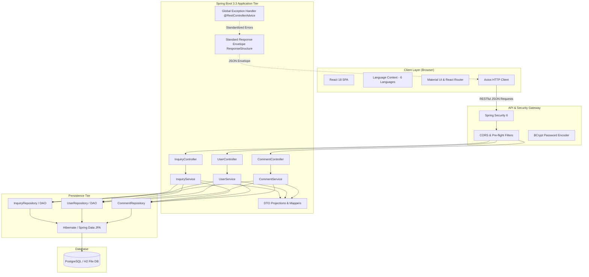
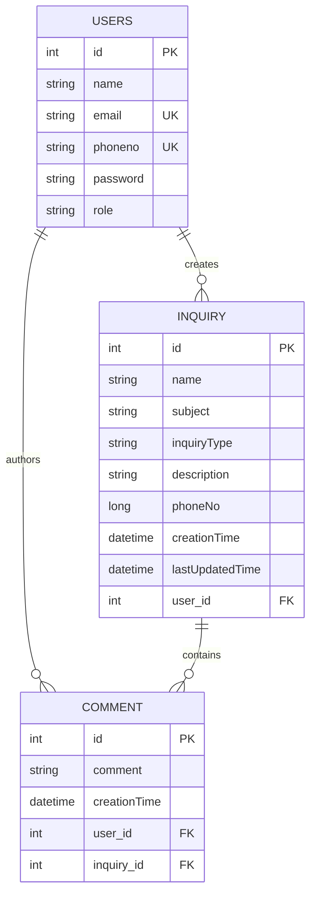

# Engineering People Help Desk: Architectural Blueprint of a Multilingual Citizen Advisory Platform

> **How we built a scalable, full-stack advisory and grievance redressal platform with Spring Boot 3, React 18, and PostgreSQL to bridge civic and domain advisory gaps across 6 languages.**

---

## 1. Introduction & The Problem We Solved

In many communities, accessing timely, expert advice on essential domains—such as **Legal Rights, Financial Literacy, Educational Schemes, Land/Property Regulations, and Healthcare**—is fraught with barriers. Information is often scattered, legal and financial terminology is dense, and most digital portals are only available in English.

To address this challenge, we designed and built **People Help Desk** ([kprsalahalu.com](https://kprsalahalu.com)). 

### Core Vision
1. **Democratize Essential Knowledge**: Deliver curated, categorized video resources spanning Law, Finance, Education, Land, and Health.
2. **Accessible Redressal & Advisory**: Provide citizens with a structured channel to submit inquiries and track resolutions.
3. **True Linguistic Inclusivity**: Native support for **6 languages** (English, Telugu, Tamil, Kannada, Malayalam, and Hindi) so users can comfortably interact in their native tongue.
4. **Collaborative Triage**: An interactive inquiry workflow where administrators and advisors can reply, comment, and resolve issues collaboratively.

Here is an in-depth exploration of the architectural decisions, patterns, and implementation strategies that power the platform.

---

## 2. High-Level System Architecture

People Help Desk follows a modern, decoupled **Client-Server Architecture**. The frontend is a responsive Single Page Application (SPA) powered by React 18, and the backend is an enterprise-grade RESTful API built with Spring Boot 3.3 and Java 17, backed by PostgreSQL.



---

## 3. Frontend Architecture (React 18 + MUI)

The frontend client is engineered for speed, high accessibility, and localization.

### 3.1 Tech Stack Highlights
- **React 18**: Concurrent features, functional components, and hooks.
- **Material UI (MUI v6) & Data Grid**: Enterprise data grids for tabular inquiry management, accessible modals, and form elements.
- **React Router v6**: Declarative client-side routing with route guards for authenticated dashboards.
- **FontAwesome**: Universal icons for domain categories.

### 3.2 Dynamic Multilingual Engine (Zero-Dependency i18n)
Rather than introducing heavy 3rd-party i18n bundles, we engineered an in-memory, reactive **Language Context** (`LanguageContext.jsx`) supporting English, Telugu, Tamil, Kannada, Malayalam, and Hindi:

```jsx
// Simplified LanguageContext structure
export const LanguageProvider = ({ children }) => {
  const [selectedLanguage, setSelectedLanguage] = useState(
    () => localStorage.getItem('selectedLanguage') || 'english'
  );

  const t = (key) => translations[selectedLanguage]?.[key] 
                 || translations.english?.[key] 
                 || key;

  const changeLanguage = (language) => {
    setSelectedLanguage(language);
    localStorage.setItem('selectedLanguage', language);
  };

  return (
    <LanguageContext.Provider value={{ selectedLanguage, changeLanguage, t }}>
      {children}
    </LanguageContext.Provider>
  );
};
```

This context persists the citizen's choice in `localStorage`, instantaneously re-rendering all labels, validation warnings, navigation options, and placeholders across the entire application tree without requiring a page refresh.

### 3.3 Route Protection & State Separation
The client segregates public users, authenticated citizens, and administrators:
- **Public / Guest Users**: Can browse educational video libraries across categories (Law, Finance, Land, Health, Education) and submit one-off emergency help requests (`/help`).
- **Authenticated Citizens**: Can access `/dashboard` to view their personal inquiry history, track progress, edit inquiries, and participate in comment threads.
- **Admins**: Granted elevated visibility to view, filter, and respond to all community inquiries across the system.

---

## 4. Backend Architecture (Spring Boot 3.3 + Java 17)

The backend is organized around the **Layered (N-Tier) Architectural Pattern**, ensuring strict separation of concerns, testability, and maintainability.

```
com.example.demo
├── Configuration/        # Security, CORS, OpenAPI Swagger
├── Controller/           # REST endpoints exposing resources
├── Dao/                  # Data Access Object abstraction
├── DTO/                  # Data Transfer Objects for clean API contracts
├── Entity/               # JPA Relational Entities
├── Exceptions/           # Domain exceptions & @RestControllerAdvice
├── repositories/         # Spring Data JPA Repositories
└── Service/              # Core business workflows & transaction boundaries
```

### 4.1 REST API Design & Standardized Response Envelope
Every API endpoint returns a standardized response envelope: `ResponseStructure<T>`.

```json
{
  "statusCode": 200,
  "message": "Inquiry saved Successfully",
  "data": { ... },
  "time": "2026-09-18T17:15:00"
}
```

This contract gives frontend consumers consistent predictability for error checking, toast notifications, and payload extraction.

### 4.2 Centralized Exception Handling
Using Spring's `@RestControllerAdvice`, exceptions are intercepted globally and translated into the unified envelope:

```java
@RestControllerAdvice
public class HandleExceptions {

    @ExceptionHandler(EntityAlreadyExistsException.class)
    public ResponseEntity<ResponseStructure<String>> handleAlreadyExists(EntityAlreadyExistsException e) {
        ResponseStructure<String> resp = new ResponseStructure<>(
            HttpStatus.CONFLICT.value(), "Entity Already Exists", e.getMessage(), LocalDateTime.now()
        );
        return new ResponseEntity<>(resp, HttpStatus.CONFLICT);
    }

    @ExceptionHandler(EntityNotFoundException.class)
    public ResponseEntity<ResponseStructure<String>> handleNotFound(EntityNotFoundException e) {
        ResponseStructure<String> resp = new ResponseStructure<>(
            HttpStatus.NOT_FOUND.value(), "Entity Not Found", e.getMessage(), LocalDateTime.now()
        );
        return new ResponseEntity<>(resp, HttpStatus.NOT_FOUND);
    }
}
```

### 4.3 Clean DTO Projections
To decouple the persistence layer from the presentation layer and avoid exposing sensitive attributes (such as encrypted password hashes), dedicated DTOs are mapped for client responses:
- `InquiryDetailsDTO`: Carries inquiry metadata alongside trimmed comment summaries.
- `CommentDetailsDTO`: Carries commentary threads without cyclic database entity references.
- `HelpRequestDTO`: Lightweight payload for guest citizens submitting inquiries.

---

## 5. Data Modeling & JPA Relationship Management

### 5.1 Entity Relationship Diagram (ERD)



### 5.2 Overcoming the JPA Circular Serialization Trap
In bidirectional relationships (`Inquiry` 1 ➔ N `Comment` ➔ 1 `Inquiry`), default JSON serializers fall into infinite loops (`Inquiry` references `Comment`, which references `Inquiry`...).

We resolved this using Jackson's `@JsonManagedReference` on `Inquiry.comments` and `@JsonBackReference` on `Comment.inquiry`, combined with dedicated DTO projections in `InquiryService`:

```java
// Inquiry.java
@OneToMany(mappedBy = "inquiry", cascade = CascadeType.ALL, orphanRemoval = true, fetch = FetchType.EAGER)
@JsonManagedReference
private List<Comment> comments = new ArrayList<>();

// Comment.java
@ManyToOne(fetch = FetchType.LAZY, optional = false)
@JoinColumn(name = "inquiry_id", nullable = false)
@JsonBackReference
private Inquiry inquiry;
```

---

## 6. Security, Authentication & Session Strategy

1. **Password Security**: Passwords are encrypted before persisting using `BCryptPasswordEncoder` with salted cryptographic hashing.
2. **Spring Security Filter Chain**: Configured to permit seamless access to public resources (`/user/register`, `/user/login`, public video feeds) while protecting user actions.
3. **CORS Flexibility**: Configured through `CorsConfig` allowing cross-origin requests from the React development server (`localhost:3000`) and the production domain (`kprsalahalu.com`).

---

## 7. Development Agility: Dual-Database Parity (H2 & PostgreSQL)

One key developer experience highlight is zero-friction setup:
- **Local Standalone Run**: Uses an embedded file-backed **H2 Database** configured in PostgreSQL compatibility mode (`MODE=PostgreSQL;DATABASE_TO_LOWER=TRUE;AUTO_SERVER=TRUE`). Developers can clone the repository and run `mvn spring-boot:run` without needing an active PostgreSQL instance running locally.
- **Production Deployment**: Uses enterprise **PostgreSQL** with complete relational integrity, indexing, and persistent transactions.

---

## 8. Summary of Key Architectural Decisions

| Decision | Choice Made | Rationale |
|---|---|---|
| **Architecture Style** | Decoupled SPA + RESTful API | Independent deployments, scalable backend, rich interactive client experience |
| **API Envelope** | `ResponseStructure<T>` | Predictable client handling for all successful and error outcomes |
| **Localization** | React Context i18n (6 languages) | Zero runtime overhead; immediate language switching across the entire UI |
| **Persistence** | Spring Data JPA + Hibernate | Rapid CRUD generation, clean DAO abstraction, transaction management |
| **Circular Prevention** | `@JsonManagedReference` + DTOs | Guarantees clean serialization without infinite recursion bugs |
| **Dev Database** | H2 in PostgreSQL mode | Immediate onboarding for new contributors without local DBMS prerequisites |

---

## 9. Conclusion & What's Next

The architecture of **People Help Desk** demonstrates that modern civic tech platforms can be robust, linguistically inclusive, and developer-friendly without over-engineering. By pairing Spring Boot's enterprise reliability with React's component agility, the platform serves as a reliable bridge between citizens and advisory experts.

### Next on the Roadmap:
- **JWT / Stateless Token Authentication**: Upgrading session credentials to short-lived JSON Web Tokens with refresh rotation.
- **Real-Time Notifications (WebSockets/SSE)**: Immediate alerts when an admin or advisor responds to an inquiry.
- **Automated Email & SMS Alerts**: Powered by Apache Velocity email templates to notify citizens when their ticket status changes.

---
*Built with ❤️ for community advisory and civic empowerment at [kprsalahalu.com](https://kprsalahalu.com).*
